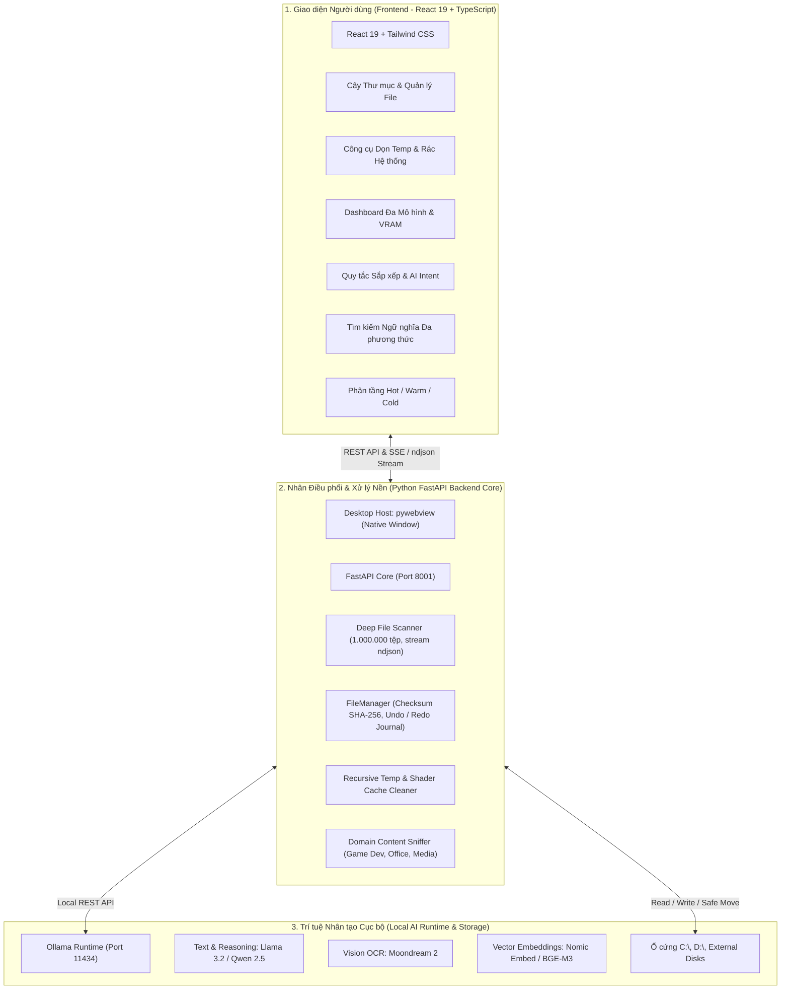

# 🌌 MMO Desktop — Multimodal Organizer

> **Hệ thống Quản lý Tệp tin Đa phương thức Thông minh & Phân tầng Lưu trữ Cục bộ với AI**
> 
> *A professional, privacy-first desktop application for intelligent file organization, neural semantic search, system temp cleaning, and storage tier optimization.*

---

## 📖 1. Giới thiệu Tổng quan (Overview)

**MMO Desktop (Multimodal Organizer)** là ứng dụng máy tính dành cho người dùng chuyên nghiệp (Developer, Content Creator, Kỹ sư, Game Dev, Nhân viên văn phòng) nhằm giải quyết bài toán:
- **Quá tải tệp tin và dữ liệu hỗn loạn** trên các ổ đĩa máy tính (C:, D:, ổ cứng di động).
- **Phân loại tệp thông minh bằng AI**: Nhận diện ngữ cảnh từng tệp (Source Code, Game Assets, Báo cáo, Đồ họa, Đa phương tiện) thay vì phân loại đuôi mở rộng thô sơ.
- **Xem trước kế hoạch sắp xếp (Dry-Run Preview)** và di chuyển an toàn với cơ chế **Hoàn tác (Undo)** & **Làm lại (Redo)** bảo toàn 100% dữ liệu.
- **Dọn dẹp rác hệ thống & Bộ nhớ tạm sâu**: Dọn `%TEMP%`, tệp tạm Windows, Crash Dumps, và bộ nhớ đệm Shader đồ họa (DirectX/NVIDIA/AMD) đệ quy, bỏ qua an toàn các tệp đang bị ứng dụng khác khóa.
- **Tìm kiếm ngữ nghĩa (Neural Semantic Search)**: Tìm file theo nội dung thực tế thay vì phải nhớ chính xác tên tệp.
- **Tối ưu hóa dung lượng ổ đĩa**: Cơ chế phân tầng Hot / Warm / Cold Tiering giúp tiết kiệm dung lượng SSD giá trị cao.
- **Đảm bảo 100% quyền riêng tư**: Mọi tiến trình phân tích nội dung, xử lý ảnh và nhúng vector đều chạy **offline/cục bộ** thông qua mô hình Small Language Models (SLM) & Ollama, không gửi bất kỳ dữ liệu nào ra ngoài Internet.

---

## 🏛️ 2. Cách thức Hoạt động (How It Works)

Kiến trúc MMO Desktop được thiết kế theo mô hình **Tam tầng Phân tách (3-Tier Decoupled Architecture)**:



### Nguyên lý vận hành chi tiết:
1. **Quét sâu cấu trúc (Deep File Scanner):**
   - Sử dụng thuật toán `os.walk` tối ưu hóa, tự động bỏ qua các kho linh kiện hệ thống không cần thiết (`WinSxS`, `Recovery`, `$WinREAgent`) để quét hơn 300.000 tệp chỉ trong 6 giây.
   - Luồng dữ liệu phản hồi theo dạng dòng `application/x-ndjson` (Server-Sent Stream) giúp giao diện cập nhật thời gian thực (số tệp đã quét, tốc độ tệp/giây, thời gian ước tính, tệp rác phát hiện).
2. **Phân tích ngữ cảnh & Phân loại Intent:**
   - Đọc lướt phần đầu tệp tin (Content Sniffer). Tự động phân loại tài liệu vào các thư mục logic chuyên ngành: `01_GameDev_Projects/`, `02_Office_Documents/`, `03_Source_Code/`, `04_Media_Assets/`...
3. **Kế hoạch Sắp xếp An toàn (Dry-Run Preview & Undo):**
   - Trước khi thực hiện chuyển file, người dùng luôn được xem bảng đối chiếu chi tiết: tệp gốc -> vị trí đích dự kiến.
   - Hỗ trợ cả 2 chế độ: **Di chuyển (Move)** hoặc **Sao chép (Copy)**.
   - Mọi thao tác di chuyển đều được ghi vào nhật ký lịch sử (`undo_journal.json`), cho phép ấn **Hoàn tác (Undo)** hoặc **Làm lại (Redo)** bất cứ lúc nào.
4. **Bảo vệ Hệ thống & Thùng rác:**
   - Các hành động xóa đều được định tuyến an toàn qua **Recycle Bin (Thùng rác)** qua thư viện `send2trash`, hoàn toàn có thể khôi phục lại khi cần.

---

## 💻 3. Hướng dẫn Cài đặt (Installation Guide)

### 3.1. Yêu cầu Hệ thống (Prerequisites)
- **Hệ điều hành:** Windows 10 / 11 (64-bit).
- **Python:** Phiên bản 3.10 hoặc 3.11. (Đảm bảo đã tích chọn *"Add Python to PATH"* khi cài đặt).
- **Node.js:** Phiên bản 18.0 trở lên (kèm `npm`).
- **Ollama (Cho tính năng AI Cục bộ):** Tải và cài đặt từ [ollama.com](https://ollama.com).

### 3.2. Cài đặt các gói phụ thuộc (Step-by-step Setup)

Mở terminal (PowerShell hoặc Command Prompt) tại thư mục gốc của dự án `d:\AI_NCKH`:

```powershell
# Bước 1: Cài đặt các thư viện Python cho Backend Core
python -m pip install -r requirements.txt

# (Nếu requirements.txt chưa đủ, cài đặt trực tiếp các thư viện chính:)
python -m pip install fastapi uvicorn requests psutil pywebview Pillow pywin32 send2trash pydantic

# Bước 2: Cài đặt phụ thuộc và biên dịch Frontend
cd frontend
npm install
npm run build
cd ..
```

---

## 🚀 4. Sau khi Cài xong: Cách Khởi động & Sử dụng (Usage Guide)

### 4.1. Khởi động Ứng dụng Desktop (1-Click Launch)
Sau khi đã cài đặt xong, bạn có thể khởi chạy ứng dụng cực kỳ đơn giản bằng **1 trong 2 cách**:

- **Cách 1 (Khuyên dùng):** Nhấp đúp chuột vào file [launch_mmo.bat](file:///d:/AI_NCKH/launch_mmo.bat) ở thư mục gốc dự án.
- **Cách 2 (Khởi chạy bằng lệnh):**
  ```powershell
  python run_desktop.py
  ```

Hệ thống sẽ tự động:
1. Kiểm tra và kết nối với Ollama AI Engine (nếu Ollama chưa mở, app sẽ nhắc mở).
2. Khởi chạy FastAPI Backend Core trên cổng nội bộ `http://127.0.0.1:8001`.
3. Mở cửa sổ Desktop Native hiện đại với giao diện dark-mode OLED.

---

### 4.2. Hướng dẫn các Chức năng Chính trong Ứng dụng

#### 1. Cây Thư mục & Quản lý File:
- Chọn ổ đĩa (`C:\`, `D:\`) hoặc gõ / dán đường dẫn mong muốn vào ô địa chỉ, bấm **Đi đến** hoặc **Chọn... (Browse)**.
- Bấm **"Quét phân tích"** để phân tích cấu trúc thư mục và phát hiện tệp rác (.tmp, .bak, .log, cache...).
- Bấm **"Dọn [X] tệp rác"** để đưa các tệp rác vào Recycle Bin.
- Bấm **"Sắp xếp thư mục"** để xem trước kế hoạch phân loại của AI -> Xác nhận di chuyển -> Có thể bấm **Hoàn tác (Undo)** nếu muốn đưa tệp trở về vị trí ban đầu.

#### 2. Công cụ Dọn Temp & Rác Hệ thống:
- Vào mục **"Dọn rác hệ thống"** ở thanh menu bên trái.
- Chọn các phân vùng cần dọn:
  - `User Temp (%TEMP%)`
  - `Windows System Temp`
  - `DirectX & GPU Shader Cache` (Cache game và card đồ họa)
  - `Windows Crash Dumps`
- Bấm **"Dọn sạch ngay"**: Tiến trình sẽ quét và xóa đệ quy các tệp rác, các tệp đang được Windows hoặc phần mềm mở khóa sẽ được tự động bỏ qua an toàn.

#### 3. Dashboard Đa Mô hình (Model Manager):
- Theo dõi dung lượng VRAM card đồ họa thời gian thực.
- Quản lý tải / xóa các mô hình Ollama AI cục bộ (`llama3.2`, `qwen2.5`, `moondream`, `nomic-embed-text`).

#### 4. Tìm kiếm Ngữ nghĩa (Semantic Search):
- Nhập câu hỏi hoặc mô tả nội dung tài liệu (ví dụ: *"hợp đồng thuê nhà 2026"*, *"thuật toán pathfinding game"*).
- AI sẽ tính toán khoảng cách vector và trích xuất đúng tệp tin liên quan nhất.

---

## 🛠️ 5. Dành cho Lập trình viên Debug (Development Mode)

Nếu muốn chỉnh sửa code và live-reload cả giao diện lẫn backend:

- **Cửa sổ 1 - Chạy Backend FastAPI:**
  ```powershell
  cd sidecar
  python -m uvicorn main:app --host 127.0.0.1 --port 8001 --reload
  ```
- **Cửa sổ 2 - Chạy Frontend Vite:**
  ```powershell
  cd frontend
  npm run dev
  ```
  *(Truy cập `http://localhost:5173` trên trình duyệt).*

- **Đóng gói ứng dụng thành file `.exe` cài đặt độc lập:**
  ```powershell
  .\package_app.bat
  ```

---

## 🛡️ 6. Cam kết An toàn Dữ liệu (Safety & Privacy)
- **100% Offline AI**: Dữ liệu và tài liệu không bao giờ bị tải lên cloud.
- **Recycle Bin Fallback**: Xóa tệp luôn qua Thùng rác hệ thống, không xóa vĩnh viễn ngoài ý muốn.
- **Safe Hardware Guard**: Giám sát nhiệt độ và VRAM card đồ họa, ngăn chặn tràn bộ nhớ GPU.

---

## 📄 7. Giấy phép (License)
Dự án nghiên cứu và phát triển phần mềm phục vụ mục đích học thuật và ứng dụng desktop mã nguồn mở. Mọi quyền được bảo lưu.
