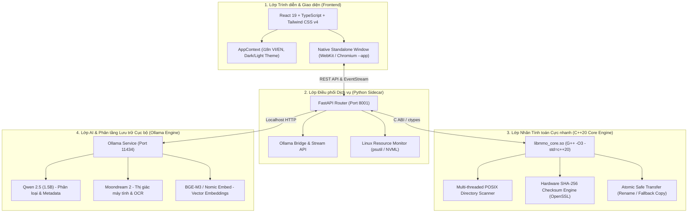

# 🌌 MMO Desktop — Multimodal Organizer (Linux Edition)

> **Hệ thống Quản lý Tệp tin Đa phương thức Thông minh & Phân tầng Lưu trữ Cục bộ với AI & C++20 Core Engine**
> 
> *A high-performance, privacy-first desktop application engineered specifically for Linux (Arch / Omarchy, Fedora, Ubuntu) featuring native POSIX directory acceleration, Small Language Models (SLM), and Neural Semantic Search.*

---

## 🏛️ 1. Kiến trúc Hệ thống trên Linux (Architecture Overview)

MMO Desktop áp dụng mô hình **Decoupled 3-Tier Architecture** được tối ưu hóa riêng cho Linux:



---

## 🚀 2. Hướng dẫn Phát triển & Biên dịch (Developer Guide)

### 2.1. Yêu cầu Môi trường (Prerequisites)
- **Hệ điều hành:** Linux (Đã kiểm thử tối ưu trên **Arch Linux / Omarchy**, Debian/Ubuntu, Fedora).
- **Trình biên dịch C++:** `g++` hoặc `clang` hỗ trợ **C++20**.
- **Thư viện hệ thống:** `openssl` (`libcrypto`), `make`.
- **Node.js & Package Manager:** Node.js v18+ & `npm`.
- **Python:** Python 3.10+ (hỗ trợ qua `mise`, `pyenv` hoặc system python).
- **Ollama:** Bắt buộc để tải và chạy các mô hình AI cục bộ.

---

### 2.2. Cài đặt & Khởi động Nền tảng AI Ollama

Trước khi khởi chạy ứng dụng hoặc tải model AI, hãy đảm bảo Ollama daemon đang chạy:

```bash
# 1. Cài đặt Ollama (nếu máy chưa có)
curl -fsSL https://ollama.com/install.sh | sh

# 2. Khởi động dịch vụ Ollama
ollama serve

# (Tùy chọn) Kích hoạt chạy nền vĩnh viễn theo systemd:
sudo systemctl enable --now ollama
```

---

### 2.3. Quy trình Biên dịch Từng bước (Step-by-Step Build)

#### Bước 1: Biên dịch C++ Core Engine
```bash
# Biên dịch thư viện chia sẻ native libmmo_core.so (-O3 tối ưu tốc độ)
make -C cpp_core
```
File `cpp_core/libmmo_core.so` sẽ được tạo và liên kết trực tiếp qua `cpp_core/mmo_bridge.py`.

#### Bước 2: Biên dịch Giao diện Frontend
```bash
cd frontend
npm install
npm run build
cd ..
```
Thư mục `frontend/dist` chứa bundle tĩnh tối ưu cho ứng dụng.

#### Bước 3: Cài đặt Thư viện Python Sidecar
```bash
# Cài đặt qua pip (hoặc mise exec -- python -m pip install ...)
pip install fastapi uvicorn requests psutil pywebview pydantic send2trash
```

---

### 2.4. Khởi chạy Ứng dụng

#### Cách 1: Chạy trực tiếp bằng Script Wrapper (Khuyên Dùng)
```bash
./launch_mmo.sh
```
Script sẽ tự động:
- Kiểm tra và tự biên dịch `libmmo_core.so` nếu chưa có.
- Kiểm tra bản build `frontend/dist`.
- Tự động fallback sang **Native Frameless App Window** nếu hệ thống thiếu binding GTK/QT của Python.

#### Cách 2: Chạy Tách biệt để Debug (Hot Reload)
Mở 2 cửa sổ terminal:
- **Terminal 1 (Backend Core & AI API):**
  ```bash
  python -m uvicorn sidecar.main:app --host 127.0.0.1 --port 8001 --reload
  ```
- **Terminal 2 (Frontend Vite Dev Server):**
  ```bash
  cd frontend
  npm run dev
  ```
  Truy cập trực tiếp tại: `http://localhost:5173`.

---

## 📂 3. Cấu trúc Dự án (Repository Structure)

```
MultiModal-Organier/
├── cpp_core/                       # Native C++20 Core Engine
│   ├── Makefile                    # Makefile tự động build libmmo_core.so
│   ├── mmo_core.cpp                # Bộ quét POSIX & SHA-256 đa luồng
│   └── mmo_bridge.py               # Ctypes bridge kết nối Python và C++
├── frontend/                       # Giao diện người dùng (React 19 + Tailwind v4)
│   ├── src/
│   │   ├── components/main/        # FileExplorer, DedicatedTempCleaner, Tiering, SemanticSearch
│   │   ├── components/preflight/   # MultiModelSelector, VramGauge, BenchmarkCard
│   │   └── lib/                    # AppContext, i18n (VI/EN), SoundManager (Web Audio API)
│   ├── package.json
│   └── vite.config.ts
├── sidecar/                        # FastAPI Router & AI Management
│   ├── main.py                     # Định tuyến API, REST endpoints, SSE streams
│   ├── file_manager.py             # Bộ điều phối tệp tin (tích hợp C++ bridge)
│   ├── hardware.py                 # Giám sát phần cứng RAM, GPU VRAM & Ollama status
│   ├── models_catalog.py           # Danh mục cụm mô hình SLM (Qwen, Moondream, BGE-M3)
│   └── ai_organizer.py             # Prompt engineering & phân loại nội dung
├── launch_mmo.sh                   # Script khởi chạy native Linux
├── run_desktop.py                  # Host Desktop khởi chạy backend & app window
└── README.md
```

---

## 🛡️ 4. Tối ưu Hóa Dành Riêng cho Linux

1. **Khắc phục lỗi nhận diện sai ổ đĩa (Drive Selector on Linux):**
   - Trên các hệ thống Linux sử dụng **Btrfs** (như Omarchy/Arch), `psutil.disk_partitions` mặc định liệt kê hàng loạt subvolume ảo (`/@`, `/@home`, `/@pkg`, `/@log`, `/boot`).
   - MMO Desktop đã tích hợp bộ lọc thông minh: gom nhóm gọn gàng thành **Home (`~`)**, **Root System (`/`)** và các thiết bị gắn ngoài (`/media`, `/run/media`, `/mnt`), ngăn chặn lỗi chọn sai đường dẫn thiết bị.
2. **Cơ chế Dọn dẹp Rác An toàn (Linux Temp Cleaner):**
   - Quét và dọn dẹp an toàn các vùng `/tmp`, `~/.cache`, `/var/tmp`.
   - Bảo vệ tuyệt đối các thư mục hệ thống cốt lõi (`/bin`, `/sbin`, `/etc`, `/usr`, `/proc`, `/sys`).
3. **Cửa sổ Ứng dụng Không Phụ thuộc X11/Wayland GTK bindings:**
   - Hỗ trợ cơ chế tự động mở giao diện Native Frameless App Window thông qua engine Chromium/Brave, không bị crash kể cả khi môi trường Python thiếu `python-gobject`.

---

## 📄 5. Giấy phép (License)
Dự án được phát triển phục vụ mục đích học thuật, nghiên cứu và phát triển phần mềm mã nguồn mở. Mọi quyền được bảo lưu.
