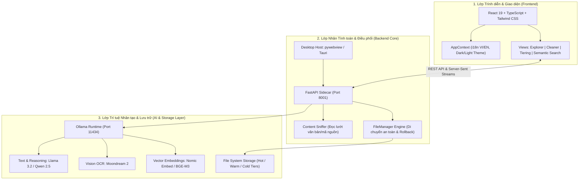

# 🌌 MMO Desktop — Multimodal Organizer

> **Hệ thống Quản lý Tệp tin Đa phương thức Thông minh & Phân tầng Lưu trữ Cục bộ với AI**
> 
> *A professional, privacy-first desktop application for intelligent file organization, neural semantic search, and storage tier optimization.*

---

## 📖 1. Giới thiệu Tổng quan (Overview)

**MMO Desktop (Multimodal Organizer)** là ứng dụng máy tính dành cho người dùng chuyên nghiệp (Developer, Content Creator, Kỹ sư, Nhân viên văn phòng) nhằm giải quyết bài toán:
- Quá tải tệp tin và dữ liệu hỗn loạn trên ổ cứng.
- Khó khăn trong việc tìm kiếm tài liệu theo nội dung thực tế thay vì nhớ tên tệp chính xác.
- Tối ưu hóa dung lượng ổ cứng SSD/HDD thông qua cơ chế phân tầng dữ liệu thực tế (Storage Tiering).
- Đảm bảo **100% quyền riêng tư**: Mọi tiến trình phân tích nội dung, xử lý ảnh và tìm kiếm vector đều chạy **offline/cục bộ** thông qua mô hình Small Language Models (SLM) & Ollama, không gửi dữ liệu ra ngoài Internet.

---

## 🏛️ 2. Kiến trúc Hệ thống (System Architecture)

Kiến trúc MMO Desktop được thiết kế theo mô hình **Tam tầng Phân tách (3-Tier Decoupled Architecture)**:



### Chi tiết các tầng:

1. **Lớp Trình diễn (Presentation Layer - Frontend):**
   - Xây dựng trên nền **React 19, TypeScript và Tailwind CSS v4**.
   - Hỗ trợ đa ngôn ngữ tập trung qua [`i18n.ts`](file:///d:/AI_NCKH/frontend/src/lib/i18n.ts) (Tiếng Việt 🇻🇳 / English 🇬🇧).
   - Hỗ trợ chuyển đổi giao diện động: **Tối (Dark) / Sáng (Light) / Hệ thống (System)**.
   - Quản lý trạng thái thư mục làm việc toàn cục (Global Directory State) và lưu trữ liên tục (`localStorage`), giúp chuyển đổi tab không bị gián đoạn tiến trình.

2. **Lớp Điều phối & Dịch vụ (Backend Core Layer):**
   - Xây dựng bằng **FastAPI & Python 3.11** đóng gói dưới dạng Sidecar.
   - **Content Sniffer:** Đọc nhanh tiêu đề và nội dung ban đầu (header snippets) của các file văn bản, mã nguồn (`.txt, .md, .py, .ts, .csv, .json...`) để phân tích ngữ cảnh thật.
   - **Tối ưu hóa tìm kiếm:** Thuật toán Pre-ranking lọc nhanh 35 file tiềm năng trước khi tính vector cosine, giúp tốc độ phản hồi chỉ từ 0.5s - 1.5s.
   - **Bảo vệ an toàn dữ liệu:** Tích hợp kiểm tra đụng độ tên tệp, bỏ qua các tệp hệ thống quan trọng và bảo vệ tệp đang chạy.

3. **Lớp AI & Phân tầng Lưu trữ (AI & Storage Tiering Layer):**
   - **Ollama Engine Cục bộ:** Quản lý vòng đời mô hình SLM chạy hoàn toàn trên GPU (GTX 1650 trở lên) hoặc CPU.
   - **Phân tầng dữ liệu:**
     - **🔥 Hot Tier ($\le$ 7 ngày):** Tệp tin đang tích cực làm việc, mã nguồn dự án đang sửa đổi.
     - **☀️ Warm Tier (7 – 45 ngày):** Tài liệu tham khảo, media ít truy cập.
     - **❄️ Cold Tier (> 45 ngày):** Tệp cũ, bản backup, gom nhóm tối ưu sang vùng lưu trữ dài hạn (`Cold_Tier_Vault`).

---

## 🚀 3. Hướng dẫn Dành cho Developer (Developer Guide)

### 3.1. Yêu cầu Môi trường (Prerequisites)
- **Node.js:** v18.0.0 trở lên & `npm`.
- **Python:** 3.10 hoặc 3.11.
- **Ollama:** Cài đặt từ [ollama.com](https://ollama.com).

### 3.2. Cài đặt Phụ thuộc (Setup Dependencies)
```powershell
# 1. Cài đặt phụ thuộc Frontend
cd frontend
npm install
cd ..

# 2. Cài đặt phụ thuộc Python Backend
python -m pip install -r requirements.txt (hoặc: fastapi uvicorn requests psutil pywebview Pillow pywin32 send2trash)
```

### 3.3. Chạy môi trường Phát triển (Development Mode)
```powershell
# Cách 1: Khởi động toàn bộ giao diện máy tính với backend tích hợp
python run_desktop.py

# Cách 2: Chạy tách biệt Frontend & Backend để debug:
# Terminal 1 - Backend:
cd sidecar
python -m uvicorn main:app --host 127.0.0.1 --port 8001 --reload

# Terminal 2 - Frontend:
cd frontend
npm run dev
```

### 3.4. Đóng gói Ứng dụng thành `.exe` (Build & Packaging)
Chỉ cần chạy file script tự động hóa:
```powershell
.\package_app.bat
```
File thực thi độc lập sẽ được tạo tại: `dist/MMO_Desktop/MMO_Desktop.exe`.

Nếu muốn khởi chạy giao diện cài đặt chọn thư mục đích (Setup Wizard):
```powershell
python make_installer.py
```

---

## 🛡️ 4. Kiểm soát An toàn Phần cứng (Hardware Guard)
- **Kiểm tra VRAM tự động:** Giám sát VRAM card đồ họa thời gian thực, ngăn chặn người dùng kích hoạt cụm mô hình vượt quá ngưỡng phần cứng máy.
- **Onboarding an toàn:** Bắt buộc người dùng cấu hình tải mô hình trước khi cho phép vào giao diện quản lý tệp tin.

---

## 📄 5. Giấy phép (License)
Phát triển phục vụ mục đích học thuật và ứng dụng desktop mã nguồn mở. Mọi quyền được bảo lưu.
